# Trendy-Wallpapers

<p align="center"><strong>Browse 4K, ultrawide and true-OLED wallpapers. Preview them on a phone or desktop frame. Export any wallpaper at your exact screen resolution — no login.</strong></p>

<p align="center">
  <a href="https://nextjs.org"></a>
  <a href="https://react.dev"></a>
  <a href="https://www.typescriptlang.org"></a>
  <a href="https://tailwindcss.com"></a>
  <a href="https://sharp.pixelplumbing.com"></a>
  <a href="#run-it-locally-in-demo-mode"></a>
</p>

<p align="center">
  <a href="docs/screenshots/home.webp">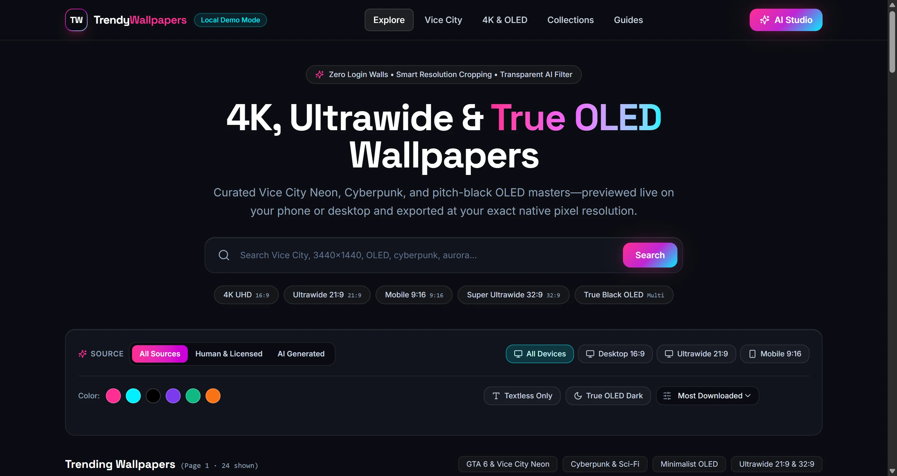</a>
</p>

<p align="center"><sub>Desktop homepage — dark-first glass UI, source/device/color filters, and a paginated gallery. Captured from the local demo build.</sub></p>

---

## What this is

Trendy-Wallpapers is a Next.js 15 (App Router, TypeScript strict) wallpaper discovery site with three things you can review straight from this README:

1. **A real gallery** — 4K / 1440p / ultrawide / 9:16 mobile wallpapers, filterable by source (human vs AI), device, dominant color, textless, and true-OLED darkness.
2. **Smart Download** — export the native original or any custom resolution as WebP, PNG, or JPG, with quick presets and an estimated-screen auto-fit.
3. **An AI Wallpaper Studio** — prompt-based generation with safety filtering, daily quotas, a global spend cap, and automatic "AI Generated" labeling.

Everything below is visible in the screenshots, runnable locally with **no external API keys**, and backed by the source in this repository.

## Screenshot tour

### Gallery — licensed photography and neon art

[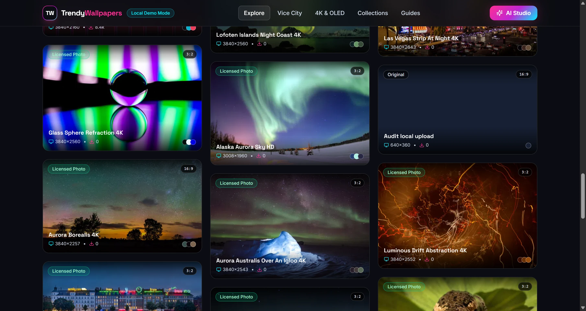](docs/screenshots/gallery-licensed.webp)

Every card shows its source badge, native resolution, download count, aspect ratio, and OLED flag. Cards reserve exact geometry from stored dimensions, so images never shift the layout while loading.

<details>
<summary><strong>More gallery views</strong></summary>

<br/>

[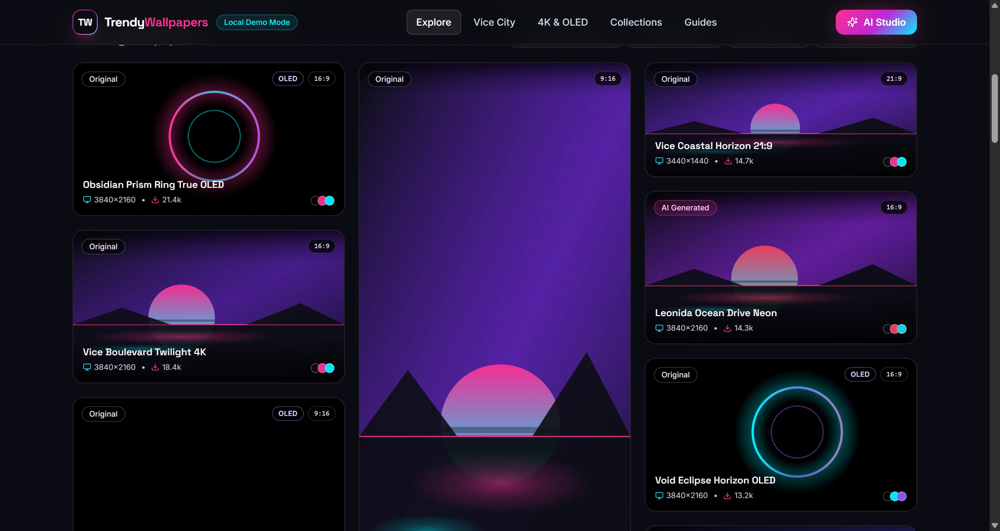](docs/screenshots/gallery-neon.webp)

[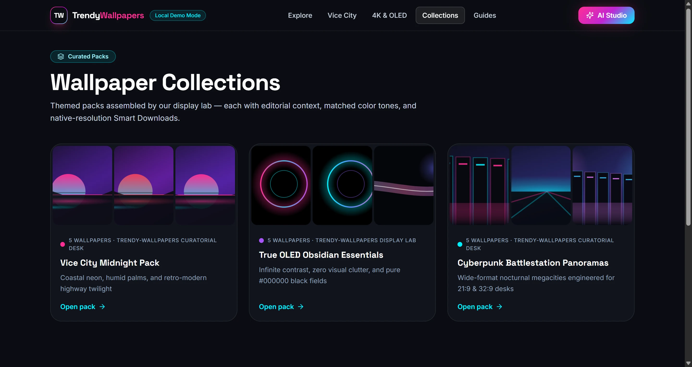](docs/screenshots/collections.webp)

</details>

### Wallpaper detail, Smart Download, and AI Studio

| Smart Download and interactive preview | AI Wallpaper Studio |
|---|---|
| [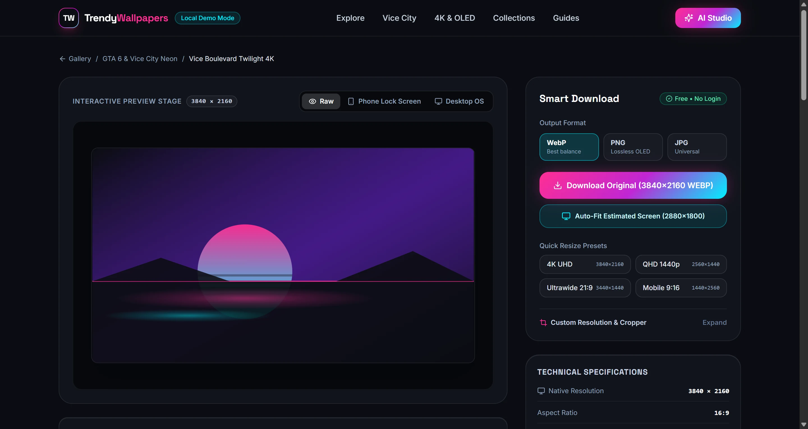](docs/screenshots/wallpaper-detail.webp) | [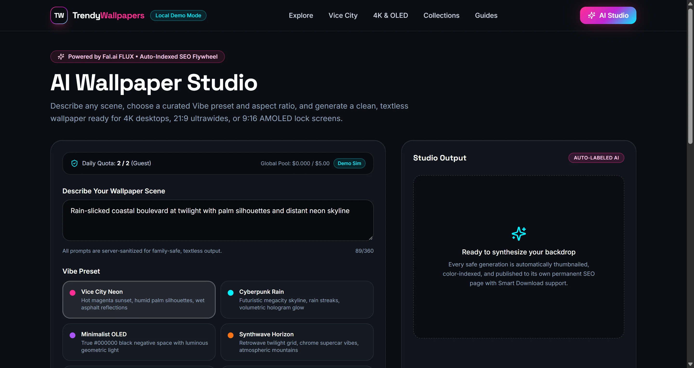](docs/screenshots/ai-studio.webp) |
| Raw / Phone Lock Screen / Desktop OS previews, dominant-color palette, technical specs, and native or custom-resolution downloads. | Prompt + curated vibe presets, aspect-ratio choices, daily quota, global spend cap, and auto-labeled output. |

<p align="center">
  <a href="docs/screenshots/mobile-detail.webp">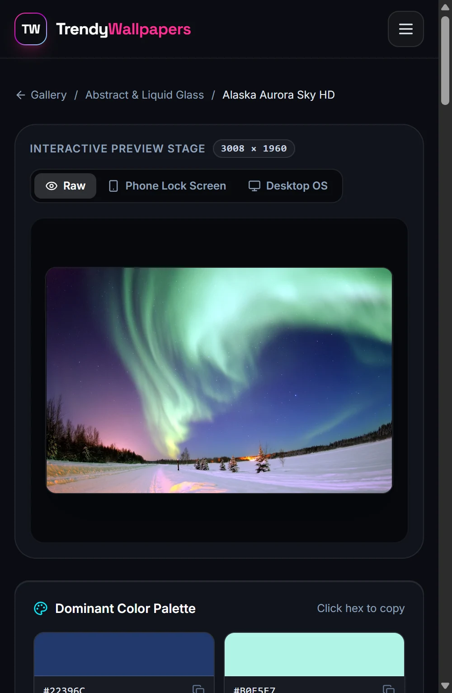</a>
  <br/>
  <sub>Responsive detail page at a phone viewport.</sub>
</p>

## Best wallpapers in the library

A sample of the freely licensed photographs shipped with the repository. Click any image to open the full thumbnail; every wallpaper detail page also displays its attribution.

| | | | |
|---|---|---|---|
| [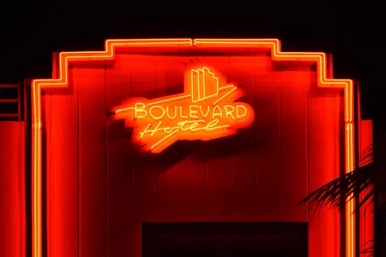](public/curated/thumbs/miami-neon-boulevard-4k-lea3.webp) | [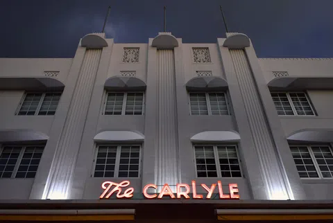](public/curated/thumbs/carlyle-neon-facade-4k-k7gs.webp) | [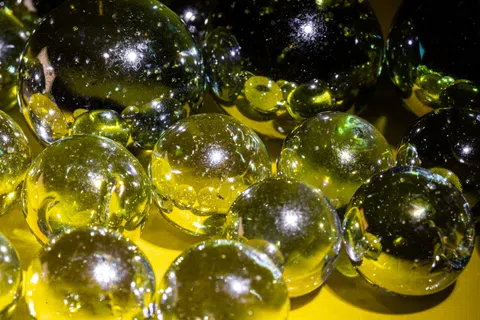](public/curated/thumbs/liquid-glass-sphere-4k-m0sn.webp) | [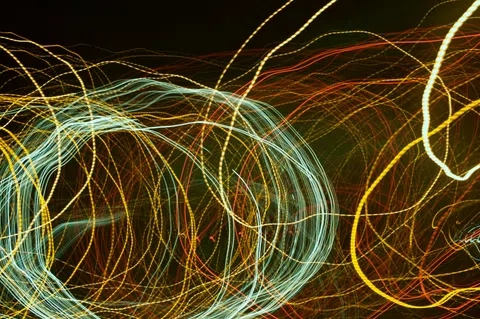](public/curated/thumbs/neon-trail-abstraction-4k-kchh.webp) |
| **Miami Neon Boulevard HD**<br/><sub>Public domain · Radomianin / Wikimedia</sub> | **Carlyle Neon Facade 4K**<br/><sub>Public domain · Radomianin / Wikimedia</sub> | **Liquid Glass Sphere 4K**<br/><sub>CC BY-SA 4.0 · Dietmar Rabich / Wikimedia</sub> | **Neon Trail Abstraction 4K**<br/><sub>CC BY-SA 2.0 · Mark J Sebastian / Wikimedia</sub> |
| [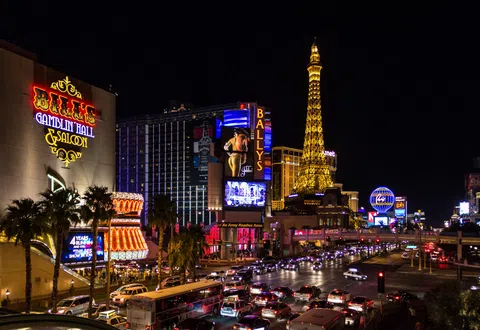](public/curated/thumbs/las-vegas-nevada-usa-the-strip-2012-6232-4k-x8i2.webp) | [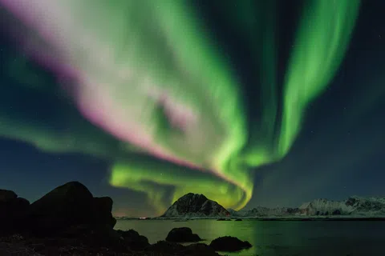](public/curated/thumbs/lofoten-norway-unsplash-4k-zaen.webp) | [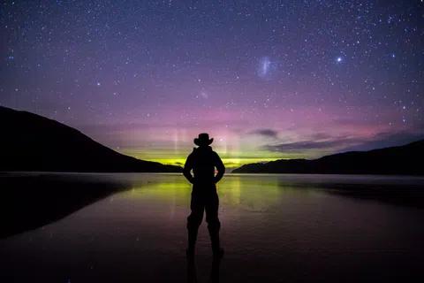](public/curated/thumbs/aurora-australis-over-the-tasman-sea-from-southwest-national-par-4k-z8bq.webp) | [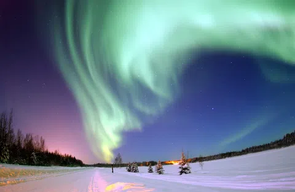](public/curated/thumbs/alaska-aurora-sky-4k-kke1.webp) |
| **Las Vegas Strip At Night 4K**<br/><sub>CC BY-SA 4.0 · Dietmar Rabich / Wikimedia</sub> | **Lofoten Islands Night Coast 4K**<br/><sub>CC0 · Johannes Groll / Wikimedia</sub> | **Aurora Australis Over The Tasman Sea 4K**<br/><sub>CC BY-SA 4.0 · Jamen Percy / Wikimedia</sub> | **Alaska Aurora Sky HD**<br/><sub>Public domain · U.S. Air Force / Wikimedia</sub> |

The demo catalog combines **18 procedural SVG wallpapers**, **17 source-controlled licensed photographs**, and any AI/admin creations you make locally. Full attribution for every licensed photo lives in [`src/data/curated-wallpapers.ts`](src/data/curated-wallpapers.ts).

## Feature tour

- **Zero-login browsing and downloads.** No account walls; downloading works from the detail page or the API.
- **Smart Download.** Native resolution or custom width/height, WebP/PNG/JPG output, quick presets (4K, QHD, 21:9, 9:16), optional contain/cover fit, and client-side validation before a link is offered.
- **Interactive preview stage.** Raw image, phone lock-screen mockup, or desktop OS mockup, rendered from the bounded 1200 px preview rather than the 4K/8K original.
- **Transparent sourcing.** Every wallpaper is labeled Original, Licensed Photo, Official Press, or AI Generated, and can be filtered as **All / Human & Licensed / AI Generated**.
- **Filter continuity and pagination.** Search, source, device, color, textless, OLED, and sort filters combine; pagination keeps them and works without JavaScript. 24 cards per page.
- **AI Studio with guardrails.** Server-side prompt safety checks, 2 free generations/day per anonymous IP, 5/day for signed-in users, and a global daily USD spend cap.
- **Editorial and legal surface.** Curated collections, three in-depth guides, JSON-LD (ImageObject / Article / CollectionPage), a sitemap, privacy/terms pages, and a DMCA takedown form.
- **Monetization-ready.** AdSense placements render only when a client ID and numeric slot IDs are configured; otherwise a height-reserved placeholder keeps the page shift-free.
- **Admin pipeline.** Authenticated upload endpoint that inspects images, extracts dominant colors, detects true-OLED darkness, builds a 480 px WebP thumbnail, and publishes to R2 + Supabase.

## Run it locally in demo mode

Requirements: Node.js with npm. No Supabase, R2, Upstash, or Fal credentials are needed.

```bash
npm install
npm run dev
```

Open **http://localhost:3000**. The header shows a **Local Demo Mode** badge.

| Route | What to review |
|---|---|
| `/` | Gallery, search, filters, sorting, pagination |
| `/category/[category]` | Category landing pages (e.g. `/category/gta-6-vice-city`) |
| `/resolution/[res]` | Resolution landing pages (`4k`, `ultrawide`, `mobile`, …) |
| `/wallpaper/[slug]` | Preview stage, palette, specs, Smart Download, related wallpapers |
| `/collections`, `/collections/[slug]` | Curated packs and editorial commentary |
| `/guides`, `/guides/[slug]` | Long-form wallpaper guides |
| `/ai-generator` | AI Wallpaper Studio (simulated output in demo mode) |
| `/about`, `/contact`, `/privacy-policy`, `/terms`, `/dmca` | Trust, legal, and takedown pages |

Demo mode is intentionally self-contained: AI generations are simulated locally, admin uploads are stored under `.uploads/` (gitignored), and demo metadata is persisted to `.demo-wallpapers.json` (gitignored). Those filesystem stores are for local review only and are not valid on serverless hosts.

## Demo mode vs live mode

| Capability | Demo mode (no keys) | Live mode (configured) |
|---|---|---|
| Catalog | Seeded + curated + local creations | Supabase `wallpapers` table with RLS |
| Images | Local files, curated files, procedural SVG | Cloudflare R2 originals + thumbnails |
| AI Studio | Simulated gradients, real quota UX | Fal.ai generation, R2 upload, Supabase publish |
| Quotas | In-process counters | Upstash Redis rate limits + daily budget |
| Ads | Reserved placeholder frames | AdSense units when client + slot IDs are set |

## Going live

1. Copy `.env.example` to `.env.local` and fill in the values for the services you want to enable.
2. Run the migrations in order in your Supabase SQL editor:
   - `supabase/migrations/001_initial_schema.sql`
   - `002_counter_rpc_permissions.sql`
   - `003_wallpaper_query_pagination.sql`
   - `004_counter_result_contract.sql`
3. Create a Cloudflare R2 bucket with a public URL (`NEXT_PUBLIC_R2_PUBLIC_URL`).
4. Configure Upstash Redis and Fal.ai. Paid AI generation requires **Fal + R2 + Supabase admin + public catalog + Redis**; a partial configuration returns `503` instead of dispatching a paid request.
5. Set `ADMIN_UPLOAD_SECRET` (16+ characters) before enabling the admin endpoint.
6. Optionally set `NEXT_PUBLIC_ADSENSE_CLIENT_ID` plus the numeric `NEXT_PUBLIC_ADSENSE_SLOT_*` IDs. Missing or invalid IDs keep the reserved placeholders.
7. Verify and build:

```bash
npm run typecheck
npm run lint
npm run build
npm run start
```

## Architecture notes

- **Catalog queries.** Live filtering is performed by the SQL function `public.query_wallpapers` (migration `003`) so all predicates — substring search, category/resolution/device/source, textless/OLED, and exact palette distance — are applied before ordering and a 25-row page fetch. Detail pages look up published slugs directly; the sitemap enumerates with a stable cursor.
- **Caching and memoization.** Default gallery page 1 uses a 60-second tagged cache. Filter combinations are memoized per render by a canonical filter key. Download derivatives use an in-memory LRU plus request coalescing and cached ETags for `304` responses.
- **Bounded image work.** A shared pipeline admits 2 active image jobs with 4 waiting requests, streams source bodies with a 40 MiB ceiling, enforces 7,680 px / 33,177,600 px output limits, and renders previews inside a 1,200 × 1,200 box.
- **Generation safety.** Quota checks reserve daily spend atomically in Redis (integer USD units) before dispatch, with a single request deadline below the client timeout. Ambiguous provider outcomes are reported, not retried automatically.
- **SEO and layout stability.** Canonical URLs, `noindex, follow` on filtered/search combinations, JSON-LD serialized with escaping, and aspect-ratio-reserved cards, preview frames, and ad slots.

Deeper implementation notes: [`docs/superpowers/efficiency-implementation-report.md`](docs/superpowers/efficiency-implementation-report.md).

## Verification

```bash
npm test          # unit tests (Node's built-in runner)
npm run test:api  # HTTP integration tests — start a demo server first
npm run benchmark # read-only by default; spawns its own isolated demo server
```

`npm run test:api` targets `BENCHMARK_URL` or `http://localhost:3000` and expects a running demo-mode server. The benchmark harness launches its own production server with sanitized demo credentials and temporary stores; mutating scenarios require `--include-mutations`.

The repository's efficiency report records this local demo-mode result set (2026-11-22, Windows, production build):

| Check | Result |
|---|---|
| Typecheck / lint / build | exit 0 |
| Unit tests | 63 passed |
| API integration | 18 passed |
| Homepage HTTP | p50 43.0 ms · p95 63.4 ms |
| Detail page HTTP | p50 10.6 ms · p95 18.4 ms |
| Cached preview HTTP | p50 4.2 ms · p95 6.0 ms |

These are localhost HTTP timings from one machine, not browser Core Web Vitals or capacity guarantees. Reproduce them with:

```bash
node scripts/benchmark.mjs --samples=30 --concurrency=1,2 --cold=1 --out=.audit/my-run.json
```

The screenshots in this README were captured from a fresh `npm run build` + `next start` run on 2026-11-23.

## Admin upload

The upload endpoint is disabled until `ADMIN_UPLOAD_SECRET` is set. It accepts JPEG, PNG, or WebP up to 40 MB and rejects anything else before image decoding.

```bash
curl -X POST http://localhost:3000/api/admin/upload \
  -H "Authorization: Bearer $ADMIN_UPLOAD_SECRET" \
  -F "file=@./master-4k.png" \
  -F "title=Vice City Midnight Rain 4K" \
  -F "description=A 150+ word editorial description of the wallpaper..." \
  -F "category_slug=gta-6-vice-city" \
  -F "source_type=original" \
  -F "tags=vice city,gta 6,4k,neon"
```

## Content credits and licensing

The 17 bundled photographs are freely licensed works from Wikimedia Commons (public domain, CC0, CC BY 2.0, or CC BY-SA 4.0). Each image's author, license, and source URL is stored with the wallpaper data and displayed on its detail page. Representative sources:

- [Boulevard Hotel neon sign, Miami Beach](https://commons.wikimedia.org/wiki/File:Boulevard_Hotel_%28Neon_sign%29,_Miami_Beach.jpg) — Radomianin, public domain
- [The Carlyle neon sign, Miami Beach](https://commons.wikimedia.org/wiki/File:The_Carlyle_%28neon_sign%29,_Miami_Beach,_east_view_up,_2018-08-21.jpg) — Radomianin, public domain
- [Glaskugeln (Liquid Glass Sphere)](https://commons.wikimedia.org/wiki/File:Glaskugeln_--_2021_--_9208.jpg) — Dietmar Rabich, CC BY-SA 4.0
- [Abstract long exposure (Neon Trail)](https://commons.wikimedia.org/wiki/File:Abstract_long_exposure_03.jpg) — Mark J Sebastian, CC BY-SA 2.0
- [The Strip, Las Vegas](https://commons.wikimedia.org/wiki/File:Las_Vegas_%28Nevada,_USA%29,_The_Strip_--_2012_--_6232.jpg) — Dietmar Rabich, CC BY-SA 4.0
- [Lofoten, Norway](https://commons.wikimedia.org/wiki/File:Lofoten,_Norway_%28Unsplash%29.jpg) — Johannes Groll, CC0
- [Aurora Australis over the Tasman Sea](https://commons.wikimedia.org/wiki/File:Aurora_Australis_Over_the_Tasman_Sea_from_SouthWest_National_Park.jpg) — Jamen Percy, CC BY-SA 4.0
- [Aurora borealis over Eielson Air Force Base](https://commons.wikimedia.org/wiki/File:Aurora_borealis_over_Eielson_Air_Force_Base,_Alaska.jpg) — U.S. Air Force, public domain

The remaining curated photos and their exact attributions are in [`src/data/curated-wallpapers.ts`](src/data/curated-wallpapers.ts). AI-generated wallpapers are labeled as such everywhere they appear.

## Project structure

```text
src/
  app/                 App Router pages and route handlers
    api/download/      Smart Download (WebP/PNG/JPG, ETag, rate limits)
    api/ai/generate/   AI Studio endpoint (quota, safety, publish)
    api/admin/upload/  Authenticated upload pipeline
    api/views/         Deduplicated, rate-limited view beacon
  components/          UI (gallery, filters, preview stage, download panel, ads)
  lib/                 Data access, image pipeline, Redis, R2, caching
  data/                Typed curated wallpaper metadata
content/guides/        MDX editorial guides
public/curated/        Source-controlled originals and thumbnails
supabase/migrations/   Schema, query function, and RPC permission migrations
tests/                 Unit and API integration suites
scripts/               Benchmark and content-migration scripts
docs/screenshots/      README screenshots
```

## Screenshot provenance

Captured locally from the production build in credential-free demo mode at 1440 × 900 (desktop) and 390 × 844 (mobile), then converted to WebP. The `Local Demo Mode` badge, sample quota, and seeded catalog are intentional demo behavior, not production data.
